# ⌨️ 키덕 (KeyDuck)

### 기계식 키보드 입문자를 위한 맞춤형 추천 웹사이트

키덕은 기계식 키보드에 익숙하지 않은 사용자도 자신에게 맞는 키보드를 쉽게 찾을 수 있도록 돕는 웹 서비스입니다.

다양한 조건으로 키보드를 검색하고, 스위치별 타건음을 들어보거나 AI 추천과 MBTI 성향 테스트를 통해 키보드를 추천받을 수 있습니다.

- **프로젝트 유형:** 대학 산학 캡스톤 팀 프로젝트
- **팀명:** team-04

---

## 📌 프로젝트 목표

기계식 키보드를 처음 접하는 사용자는 스위치, 키 배열, 연결 방식 등 다양한 용어와 제품 사양 때문에 키보드를 선택하기 어려울 수 있습니다.

키덕은 사용자가 원하는 조건을 직접 선택하거나 자연어로 입력하여 키보드를 찾고, 스위치별 타건음을 미리 들어볼 수 있도록 하여 키보드 선택을 돕는 것을 목표로 합니다.

---

## ✨ 주요 기능 및 화면

### 🏠 메인 페이지

- 추천 키보드를 슬라이드로 확인할 수 있습니다.
- 튜토리얼을 열고 닫으며 서비스 이용 방법을 확인할 수 있습니다.
- 필터 검색, 타건 테스트, AI 추천, MBTI 추천 기능으로 이동할 수 있습니다.

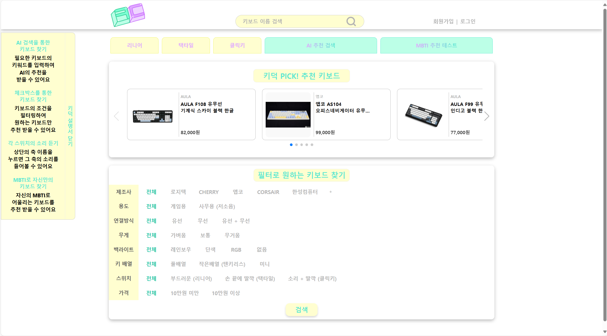

---

### 🔍 키보드 이름 검색

- 상단 검색창에 키보드 이름을 입력하여 검색할 수 있습니다.
- 검색 결과를 목록으로 확인할 수 있습니다.

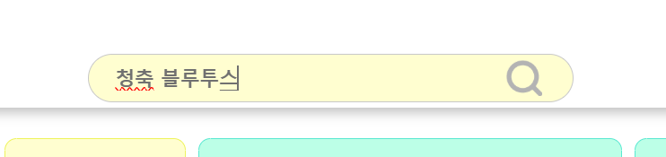

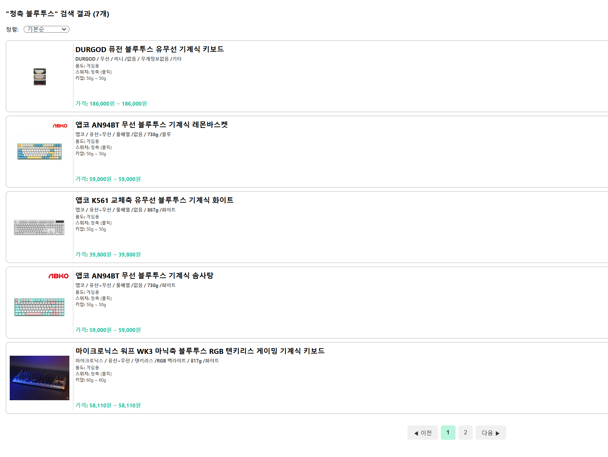

---

### 🎛️ 필터 검색

- 제조사, 용도, 연결 방식, 무게, 백라이트, 키 배열, 스위치, 가격을 조건으로 선택할 수 있습니다.
- 여러 조건을 선택하여 원하는 키보드를 검색할 수 있습니다.
- 검색 결과를 낮은 가격순 또는 높은 가격순으로 정렬할 수 있습니다.
- 검색 결과를 페이지별로 확인할 수 있습니다.

**필터 검색 및 결과**

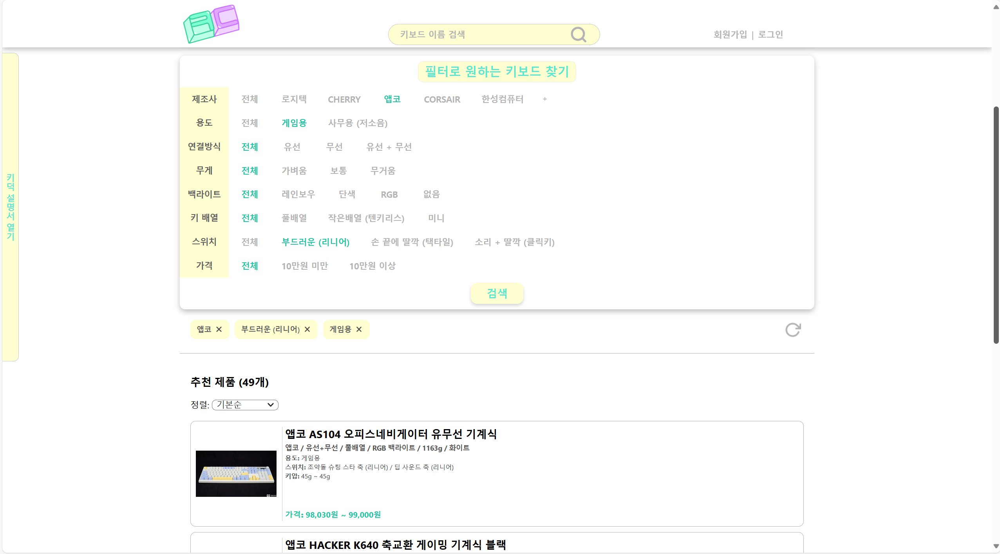

**낮은 가격순 정렬**

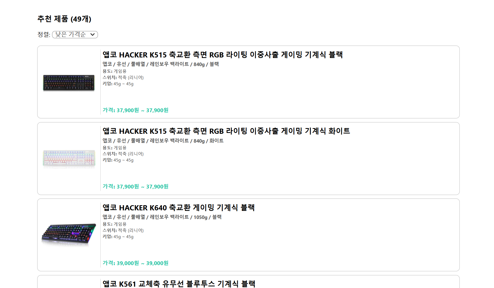

**키보드 목록 및 페이지 이동**

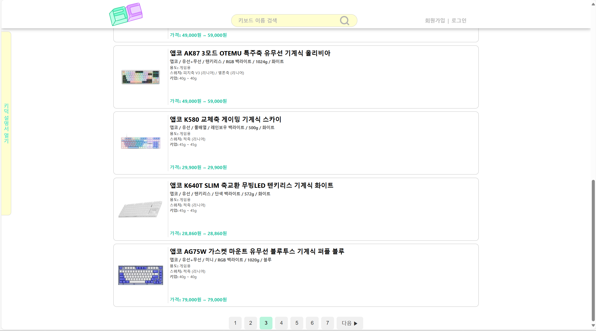

---

### 📋 키보드 상세 페이지

- 제조사, 연결 방식, 무게, 백라이트, 키 배열, 하우징 색상 등 키보드 사양을 확인할 수 있습니다.
- 동일한 모델의 스위치별 가격 정보와 구매 링크를 확인할 수 있습니다.
- 유사한 키보드를 추천받을 수 있습니다.
- 댓글을 작성하고 확인할 수 있습니다.
- 하트 버튼을 눌러 관심 있는 키보드를 찜할 수 있습니다.

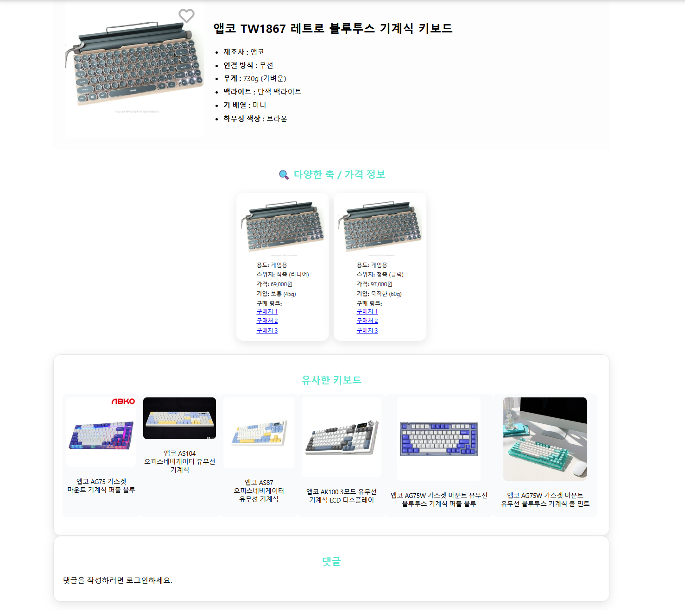

---

### 🎹 스위치 타건 테스트

- 리니어, 택타일, 클릭키 중 원하는 스위치를 선택할 수 있습니다.
- 키보드의 키를 눌러 스위치와 키 종류에 따른 타건음을 들어볼 수 있습니다.

**스위치 선택**

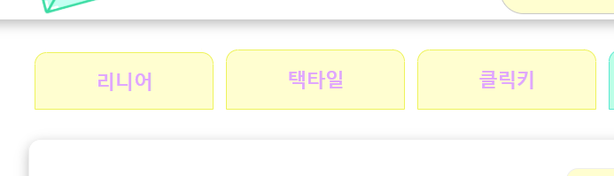

**타건 테스트**

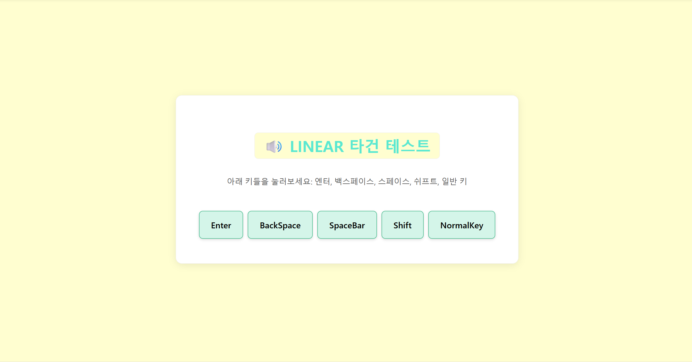

---

### 🤖 AI 키보드 추천

- 원하는 키보드 조건을 자연어로 입력할 수 있습니다.
- GPT가 입력 내용을 분석하여 조건에 맞는 키보드를 추천합니다.
- 추천 결과와 적용된 검색 조건을 확인할 수 있습니다.

**AI 추천 검색 버튼**

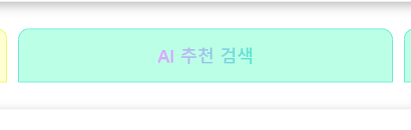

**AI 추천 검색 화면**

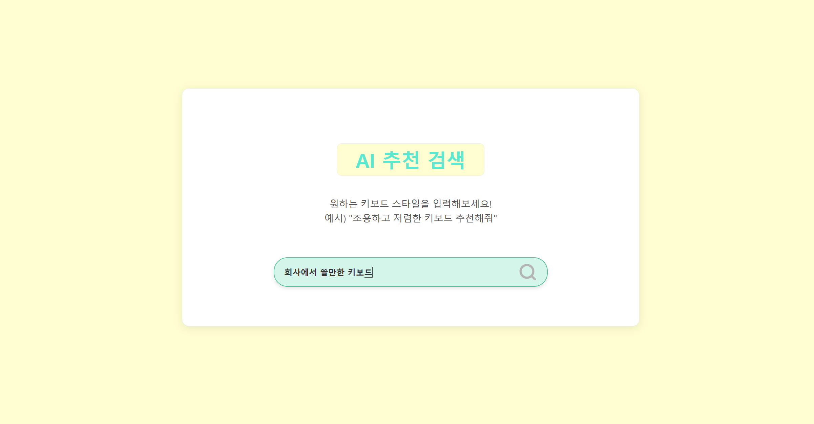

**AI 추천 결과**

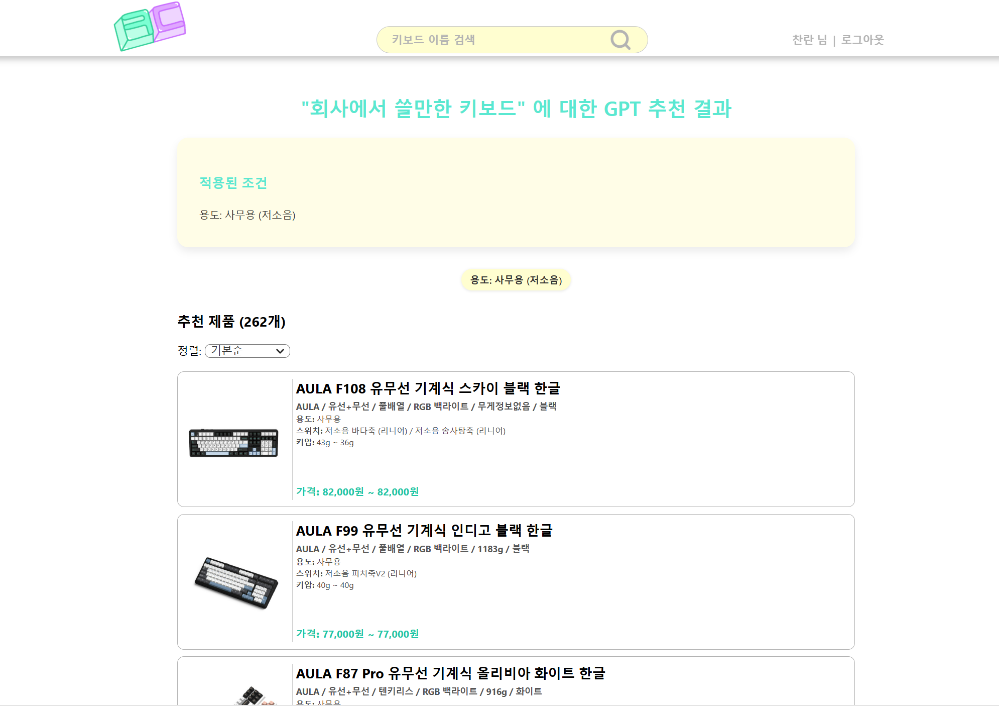

---

### 🧩 MBTI 성향 기반 추천

- 12개의 질문에 답변하는 성향 테스트를 제공합니다.
- 테스트 결과를 기반으로 키보드를 추천합니다.

**MBTI 추천 테스트 버튼**

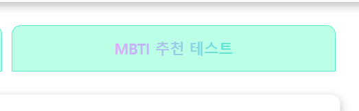

**MBTI 추천 테스트**

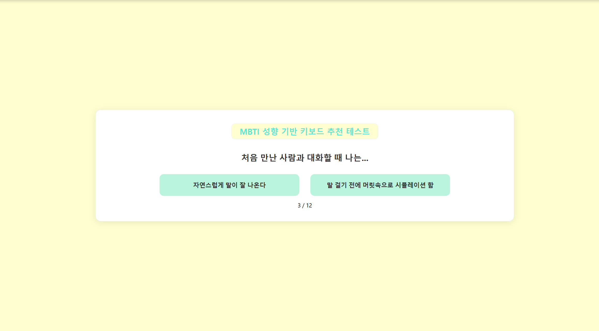

---

### 👤 회원 관리

- 회원가입, 로그인, 로그아웃 기능을 제공합니다.
- 가입한 이메일을 이용한 아이디 찾기와 임시 비밀번호 발급 기능을 제공합니다.
- 마이페이지에서 비밀번호 변경과 회원 탈퇴가 가능합니다.
- 로그인한 사용자는 자신의 찜 목록을 확인할 수 있습니다.

**회원가입**

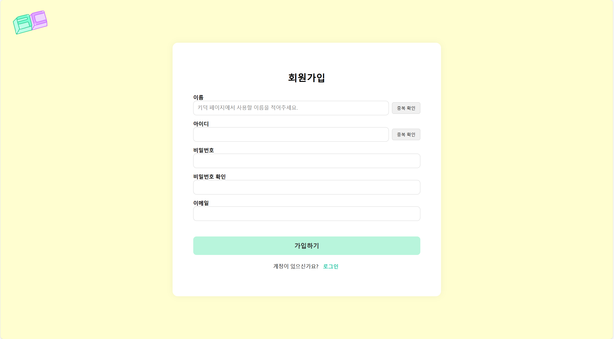

**로그인**

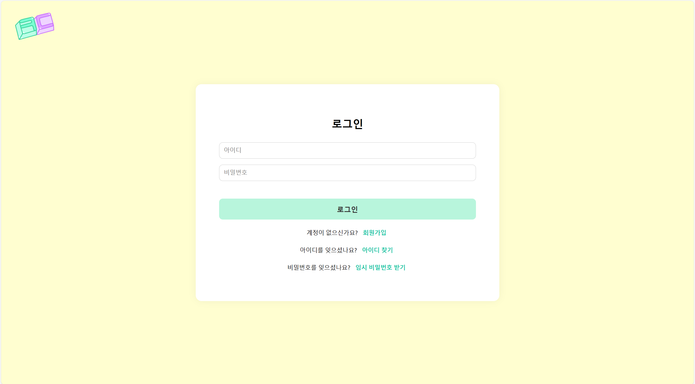

**로그인 성공 화면**

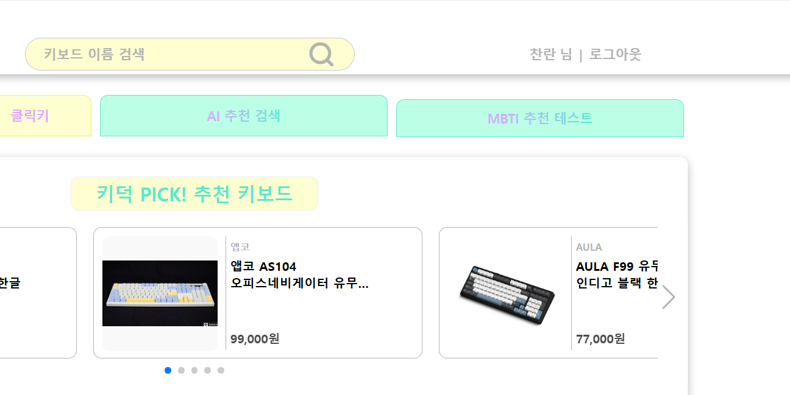

**마이페이지**

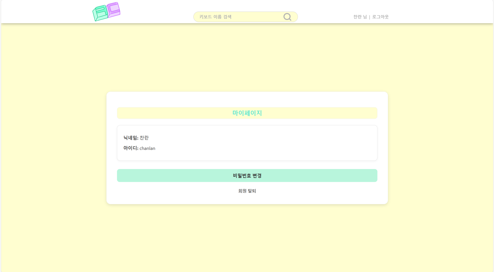

---

## 🛠 기술 스택

### Frontend

- React
- HTML
- CSS

### Backend

- Spring Boot
- Spring Security
- JPA
- JWT
- QueryDSL
- MySQL

### 배포 및 협업

- AWS EC2
- AWS S3
- Nginx
- Figma
- Notion
- Git / GitHub

---

## 👥 팀 구성

| 이름 | 담당 |
| --- | --- |
| 오찬란 | 프론트엔드 |
| 이세화 | UI 설계 및 아이디어 제안 |
| 김정민 | 백엔드 |
| 박호성 | 키보드 데이터 크롤링 |
| 서 적 | CSV 데이터의 SQL 구현 |

---

## 🔗 관련 저장소

- [백엔드 저장소](https://github.com/jeongmy/keyboard-project)
